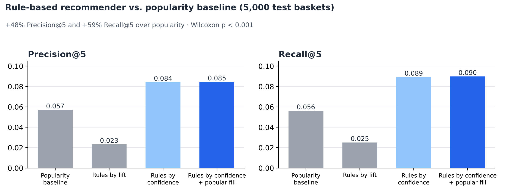
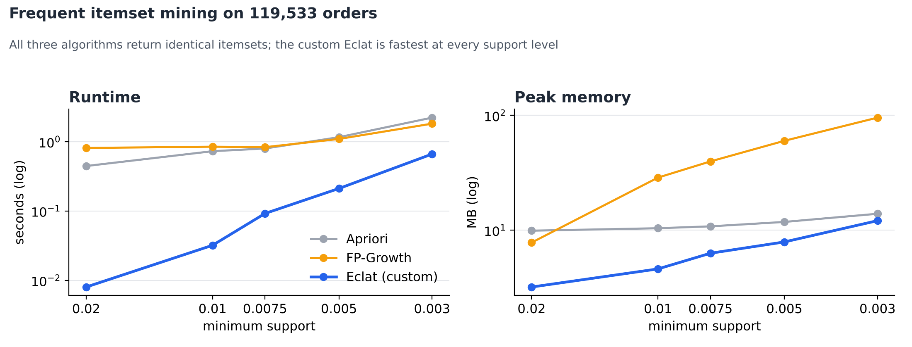

# 🛒 Product Recommender with Association Rules

[](https://colab.research.google.com/github/hgalvaradot/instacart-association-rules-recommender/blob/main/notebooks/INSTACART-ASSOCIATION-RULES-RECOMMENDER.ipynb)


Association rule mining and a product recommender built on **119,533 real grocery orders** from the Instacart Market Basket Analysis dataset. It compares Apriori, FP-Growth and a **custom Eclat implementation**, serves recommendations in a **Gradio app**, and evaluates them against a popularity baseline.

> The notebook is written in Spanish.

## Key results

- The rule-based recommender beats the popularity baseline by **+48% Precision@5** and **+59% Recall@5** (Wilcoxon signed-rank test, p < 0.001).
- It recommends **2,288 distinct products** instead of the same 9, so suggestions adapt to each basket.
- The custom **Eclat** was the **fastest of the three algorithms** at every support level, with identical results to mlxtend.
- With 20% less training data, Precision@5 barely moves (0.086 → 0.085) and the lift of shared rules stays stable (Spearman ρ = 0.99).



## Data

- Public dataset: [Instacart Market Basket Analysis](https://www.kaggle.com/datasets/psparks/instacart-market-basket-analysis) (3.4M orders, 33.8M order-product records, 49,688 products).
- The notebook downloads it automatically with `kagglehub`, so **no data is stored in this repository**.
- Sample: 7,306 complete users (120,003 orders), sampled by user so each customer's purchase sequence is preserved.
- Outlier baskets removed with Tukey's fence (Q3 + 3·IQR, more than 41 products): 0.39% of orders that generated 5.9% of all product pairs.

## Approach

| Step | What was done |
|---|---|
| **1. Preparation** | Integration of orders, products, aisles and departments; user-level sampling; outlier removal; time-aware 70/30 split per user |
| **2. Frequent itemsets** | Apriori and FP-Growth (mlxtend) vs. Eclat written from scratch with bitset tidsets, benchmarked on runtime and peak memory at five support levels |
| **3. Rules** | 905 rules scored with support, confidence, lift, leverage, conviction and Jaccard; redundant rules removed with Bayardo's minimum improvement criterion |
| **4. Patterns** | Rules by department, day of week, hour, basket size and customer stage, plus cross-department rules |
| **5. Misleading rules** | Chi-square significance and train/test stability to discard rules that only look strong because the consequent is popular |
| **6. Recommender** | Product-to-product rules from sparse co-occurrence (XᵀX), served in a Gradio app |
| **7. Evaluation** | 5,000 test baskets with half of the products hidden; Precision@5, Recall@5, catalog coverage and latency |
| **8. Robustness** | Rules rebuilt with 10–20% less training data and with support ×0.8, ×1.5 and ×2 |



## Full results

| System | Precision@5 | Recall@5 | Catalog coverage |
|---|---|---|---|
| **Rules ranked by confidence + popular fill** | **0.0845** | **0.0899** | **7.6%** |
| Rules ranked by confidence | 0.0843 | 0.0892 | 7.6% |
| Popularity baseline | 0.0571 | 0.0562 | 0.03% |
| Rules ranked by lift | 0.0233 | 0.0251 | 16.2% |

Ranking by lift backfires: it favors rare products with very few transactions and performs worse than popularity.

## Project structure

```
├── notebooks/
│   └── INSTACART-ASSOCIATION-RULES-RECOMMENDER.ipynb   # full analysis, executed
├── src/
│   └── nucleo_reglas.py      # binary matrix, rule generation, metrics and recommender
├── images/                   # figures used in this README
├── requirements.txt
└── LICENSE
```

## How to run

**Google Colab (recommended):** click the *Open in Colab* badge and run all cells. The Gradio app gets a public link at the end of Part 6.

**Locally:**

```bash
git clone https://github.com/hgalvaradot/instacart-association-rules-recommender.git
cd instacart-association-rules-recommender
pip install -r requirements.txt
jupyter notebook notebooks/INSTACART-ASSOCIATION-RULES-RECOMMENDER.ipynb
```

The dataset is downloaded with `kagglehub`. To use a local copy instead, put the CSVs in a `data/` folder.

## Tech stack

Python · pandas · NumPy · SciPy · mlxtend · Gradio · Matplotlib · seaborn · Google Colab

## Author

**Héctor Giovani García Alvarado** — AI Engineering student, ESCOM-IPN

[LinkedIn](https://www.linkedin.com/in/hector-alvarado-b66a16424) · [GitHub](https://github.com/hgalvaradot)
